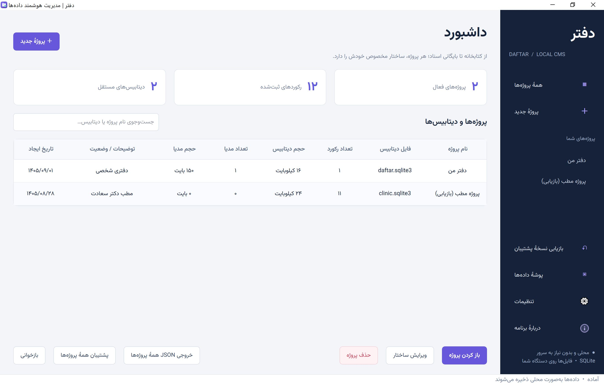

# دفتر | Daftar

**دفتر** یک سامانهٔ مدیریت محتوا و دیتابیس محلی، بدون سرور و آفلاین است که با Python و PySide6 ساخته شده. هر پروژه دیتابیس SQLite مستقل خودش را دارد و می‌توانید فرم‌های پویا، رکوردها، پیوست‌ها، جست‌وجو و پشتیبان‌گیری را بدون نیاز به نصب ابزارهای جانبی مدیریت کنید.

**Daftar** is a local, serverless, offline CMS/database desktop app built with Python and PySide6. Each project gets its own SQLite database, with dynamic forms, records, attachments, search, and backups — no external server or database setup required.

---

## ویژگی‌ها | Features

### فارسی
- **کاملاً محلی و آفلاین**: بدون سرور، بدون وابستگی ابری؛ داده‌ها روی دستگاه شما ذخیره می‌شوند.
- **پروژه‌های مستقل**: هر پروژه دیتابیس SQLite جداگانه، پوشهٔ پیوست و ساختار فیلد مخصوص خود را دارد.
- **فرم‌ساز پویا**: انواع فیلد شامل متن کوتاه/بلند، متن غنی، ویرایشگر HTML، عدد صحیح، اعشاری، فایل، تصویر، PDF، رادیو، انتخابی، چک‌باکس، تاریخ، ساعت و تاریخ‌وساعت.
- **تنظیمات پیشرفتهٔ فیلد**: الزامی، یکتا (برای متن کوتاه/عدد صحیح)، نمایش در جدول، مقدار پیش‌فرض/راهنما، محدودهٔ طول، محدودهٔ مقدار عددی، تعداد دقیق رقم، پسوندهای مجاز، گزینه‌ها و تقویم پیش‌فرض.
- **جدول رکوردها**: جست‌وجو، مرتب‌سازی، نمایش انتخابی ستون‌ها، راست‌چین در فارسی، ناوبری سریع بین رکوردها (اولین/قبلی/بعدی/آخرین/پرش به شماره).
- **پیوست‌ها**: افزودن چند فایل/تصویر/PDF، پیش‌نمایش، حذف تکی، نگهداری امن در پوشهٔ پروژه.
- **تاریخ و ساعت**: تقویم شمسی و میلادی، انتخابگر ساعت ۲۴ ساعته، ذخیرهٔ استاندارد در دیتابیس و نمایش شمسی با اعداد فارسی در رابط فارسی.
- **پشتیبان‌گیری و بازیابی**: پشتیبان ZIP پروژه یا همهٔ پروژه‌ها به‌همراه پیوست‌ها و تنظیمات؛ خروجی JSON و CSV.
- **دو زبانه**: فارسی (RTL) و انگلیسی (LTR) با تغییر فوری از منوی تنظیمات.
- **رابط دسکتاپ مدرن**: ساخته‌شده با PySide6، فونت وزیرمتن، طراحی کارت‌محور و جدول خوانا.

<p align="center">
  
</p>
<hr>


### English
- **Fully local & offline**: No server, no cloud dependency; your data stays on your machine.
- **Independent projects**: Each project has its own SQLite database, attachment folder, and field schema.
- **Dynamic form builder**: Field types include short/long text, rich text, HTML editor, integer, decimal, file, image, PDF, radio, select, checkbox, date, time, and datetime.
- **Advanced field settings**: Required, unique (short text/integer), show in table, placeholder/help, length limits, numeric value range, exact digits, allowed extensions, options, and default calendar.
- **Records table**: Search, sort, selectable columns, right-aligned in Persian / left-aligned in English, quick record navigation (first/prev/next/last/jump to position).
- **Attachments**: Multiple file/image/PDF attachments, preview, per-item removal, safe storage inside the project folder.
- **Date & time**: Jalali and Gregorian calendars, 24-hour time picker, standard storage, Jalali display with Persian digits in Persian UI.
- **Backup & restore**: ZIP backup for one project or all projects including attachments and settings; JSON and CSV export.
- **Bilingual UI**: Persian (RTL) and English (LTR), switch instantly from Settings.
- **Modern desktop UI**: Built with PySide6, Vazirmatn font, card-based layout, readable tables.

---

## اجرای برنامه | Run from source

### پیش‌نیاز | Requirements
- Python 3.11+ (recommended 3.12/3.14)
- Windows / Linux / macOS (developed and packaged primarily for Windows)

### نصب و اجرا | Install & run

```bash
# clone
git clone https://github.com/<your-username>/daftar.git
cd daftar

# create venv
python -m venv .venv

# activate (Windows PowerShell)
.\.venv\Scripts\Activate.ps1
# activate (Linux/macOS)
# source .venv/bin/activate

# install dependencies
pip install -r requirements.txt

# run
python main.py
```

---

## ساخت فایل اجرایی ویندوز | Build Windows EXE

برای ساخت یک فایل تک‌اجرایی ویندوز (بدون نیاز به نصب پایتون برای کاربر نهایی):

To build a single-file Windows executable (end users do not need Python installed):

```bash
pip install pyinstaller
pyinstaller --noconfirm --clean --onefile --windowed --name Daftar --add-data "assets;assets" main.py
```

خروجی در مسیر `dist/Daftar.exe` قرار می‌گیرد. در اولین اجرا، پوشهٔ `data` کنار فایل exe ساخته می‌شود.

Output will be at `dist/Daftar.exe`. On first run, a `data` folder is created next to the executable.

---

## ساختار داده‌ها | Data layout

```text
data/
  catalog.sqlite3                # project catalog / فهرست پروژه‌ها
  settings.json                  # app settings / تنظیمات برنامه
  <project-id>/
    <db-name>.sqlite3            # project database / دیتابیس پروژه
    assets/                      # attachments / پیوست‌ها
```

> پوشهٔ `data` در حالت اجرای سورس کنار پروژه و در حالت exe کنار فایل اجرایی ساخته می‌شود.

> In source mode, `data` is created next to the project; in frozen/exe mode, next to the executable.

---

## پشتیبان‌گیری | Backup

- **پشتیبان پروژه**: خروجی ZIP شامل دیتابیس پروژه، پیوست‌ها و متادیتا.
- **پشتیبان کامل**: خروجی ZIP شامل همهٔ پروژه‌ها، پیوست‌ها و تنظیمات.
- **بازیابی**: فایل ZIP پشتیبان را از منوی مربوطه بازیابی کنید.
- **خروجی**: JSON و CSV نیز برای خروجی گرفتن داده‌ها در دسترس هستند.

- **Project backup**: ZIP containing project DB, attachments, and metadata.
- **Full backup**: ZIP containing all projects, attachments, and settings.
- **Restore**: Restore from a backup ZIP through the app menu.
- **Export**: JSON and CSV exports are also available.

---

## تکنولوژی‌ها | Tech stack

- Python
- PySide6 (Qt for Python)
- SQLite
- jdatetime (Jalali calendar)
- Vazirmatn font

---

## توسعه | Development

```bash
# run tests
python -m unittest discover -s tests
```

ساختار اصلی کد:

```text
main.py              # app entry point
cms/
  storage.py         # SQLite storage, validation, backup/export
  window.py          # main window, project/records views
  dialogs.py         # project/field/record/settings dialogs
  widgets.py         # custom widgets (date/time/rich editor/attachments)
  i18n.py            # translations (fa/en)
  theme.py           # Qt stylesheet
assets/
  fonts/             # Vazirmatn
  app_icon.svg
tests/
  test_cms.py
```

---

## مجوز | License

در صورت نیاز یک فایل `LICENSE` اضافه کنید. اگر مخزن عمومی است، مجوز مناسب (مثلاً MIT) توصیه می‌شود.

Add a `LICENSE` file if needed. For a public repository, a permissive license such as MIT is recommended.

---

## مشارکت | Contributing

Issue و Pull Request خوش‌آمد هستند. لطفاً قبل از PR های بزرگ، موضوع را در Issue مطرح کنید.

Issues and pull requests are welcome. For large changes, please open an issue first to discuss the proposal.
